

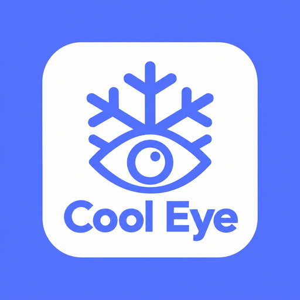

# 🧊 IDCool

### 냉동·냉장 시설 실시간 통합 관제 플랫폼
### Real-time Integrated Monitoring Platform for Cold Storage Facilities

**언어 선택 · Choose your language**

[🇰🇷 한국어로 보기](#-한국어) &nbsp;·&nbsp; [🇬🇧 Read in English](#-english)

 

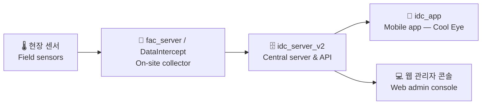

---

## 🇰🇷 한국어

### ❓ 이게 뭔가요?

냉동·냉장 창고는 온도 하나만 삐끗해도 재고 전체가 손상될 수 있습니다.
**IDCool**은 창고 현장의 센서(온도, 가스 압력, 압축기 상태 등)를 실시간으로 읽어서,
**모바일 앱**과 **웹 관리자 콘솔**로 누구나 쉽게 확인하고 이상 상황에 대응할 수 있게 해주는
통합 관제 시스템입니다.

- 🧑‍🔧 **현장 직원**은 손 안의 폰으로 담당 시설의 온도와 알람을 실시간 확인
- 🧑‍💻 **관리자**는 웹 콘솔에서 모든 시설/센서를 설정하고 직원 권한을 관리
- 🚨 이상이 생기면 **즉시 알람**이 울리고, 기록은 차트로 남아 나중에도 추적 가능

### 👀 모바일 앱 (Cool Eye) 둘러보기

<table>
<tr>
<td width="33%" align="center">
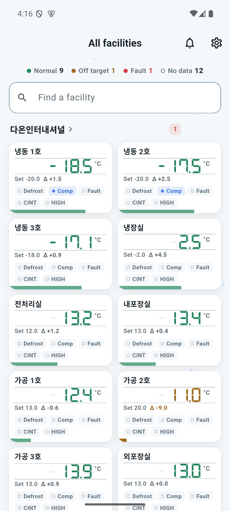 
<b>전체 시설 한눈에 보기</b> 담당 시설의 정상/이상 상태를 색으로 바로 확인
</td>
<td width="33%" align="center">
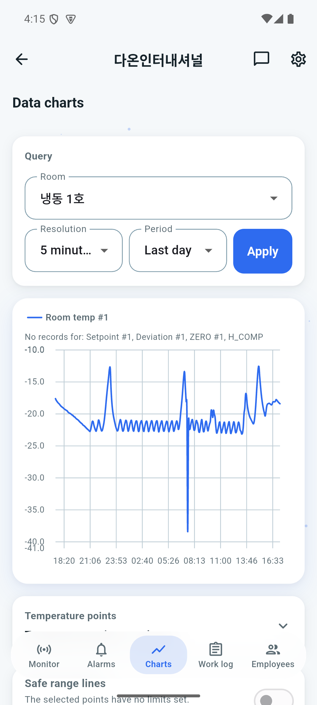 
<b>실시간 데이터 차트</b> 온도 추이를 기간별로 조회
</td>
<td width="33%" align="center">
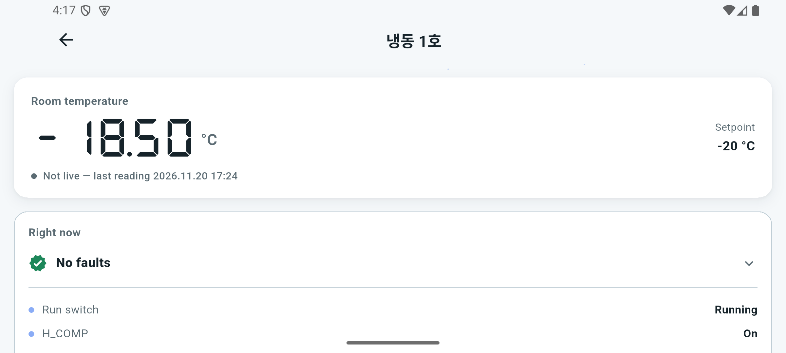 
<b>가로모드 간편 보기</b> 큰 숫자로 현재 값을 멀리서도 확인
</td>
</tr>
<tr>
<td width="33%" align="center">
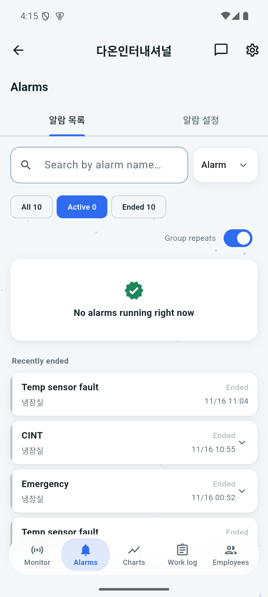 
<b>알람</b> 진행 중/종료된 알람을 한곳에서 관리
</td>
<td width="33%" align="center">
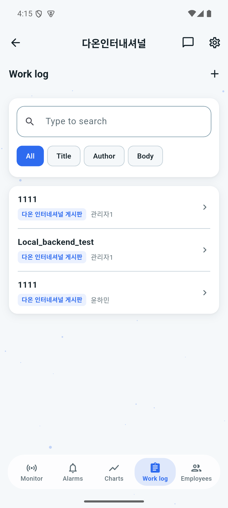 
<b>소요기록 게시판</b> 현장 이슈와 작업 내역을 글로 공유
</td>
<td width="33%" align="center">
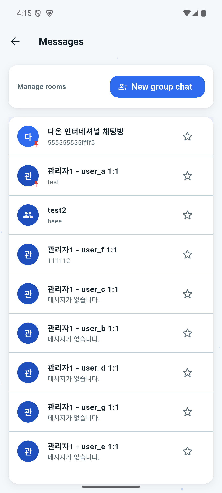 
<b>메시지</b> 관리자·직원 간 1:1 / 그룹 채팅
</td>
</tr>
<tr>
<td width="33%" align="center">
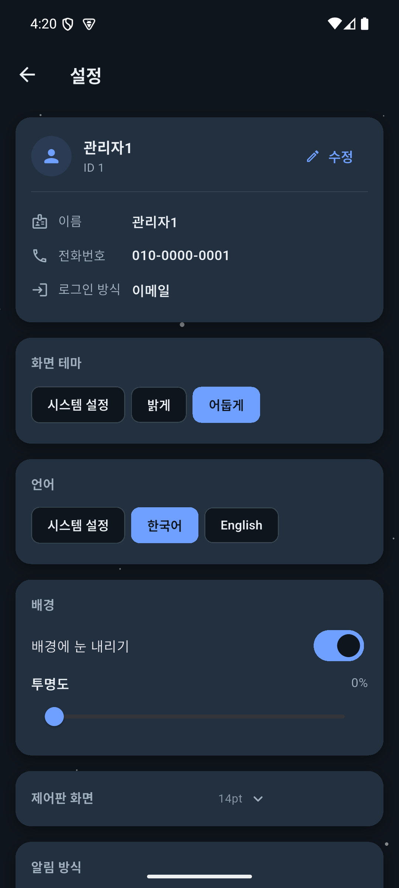 
<b>설정 — 다크모드 & 언어</b> 한국어 ↔ English, 라이트 ↔ 다크 즉시 전환
</td>
<td width="33%" align="center">
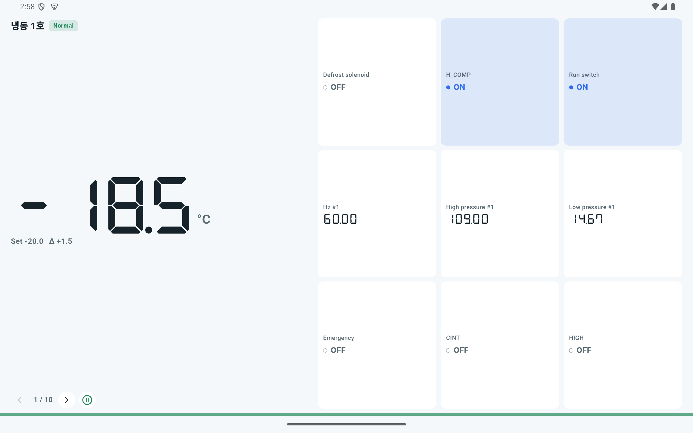 
<b>태블릿 자동 슬라이드</b> 현장에 거치해두면 화면이 자동으로 넘어가는 관제판
</td>
<td width="33%" align="center">
+ 근무일지, 직원 관리, 온도 안전 범위 알림 등 더 많은 기능이 있습니다 🙂
</td>
</tr>
</table>

### 🖥️ 웹 관리자 콘솔 둘러보기

<table>
<tr>
<td width="50%" align="center">
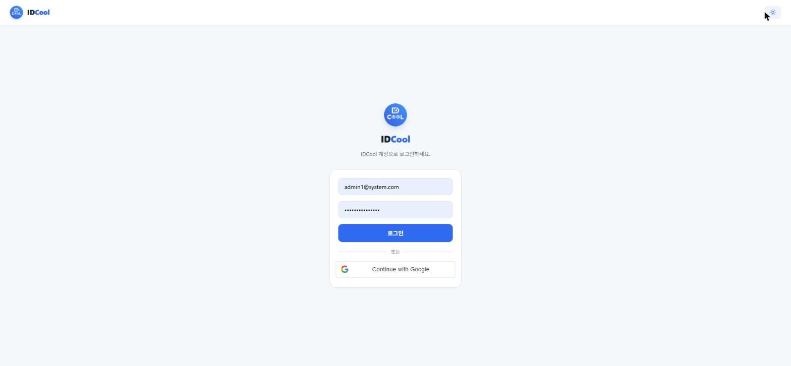 
<b>로그인</b> 이메일 또는 구글 계정으로 로그인
</td>
<td width="50%" align="center">
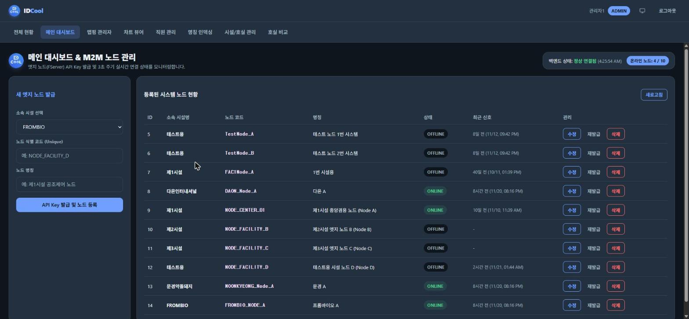 
<b>M2M 노드 관리</b> 현장 엣지 노드의 API Key 발급 및 연결 상태 모니터링
</td>
</tr>
<tr>
<td width="50%" align="center">
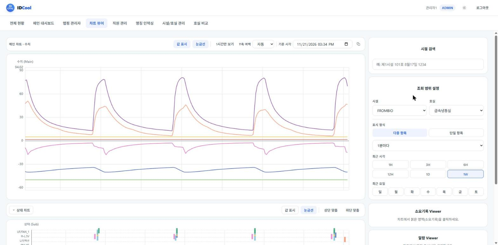 
<b>실시간 차트 뷰어</b> 여러 센서 값을 겹쳐 보고, 소요기록·알람 구간까지 함께 확인
</td>
<td width="50%" align="center">
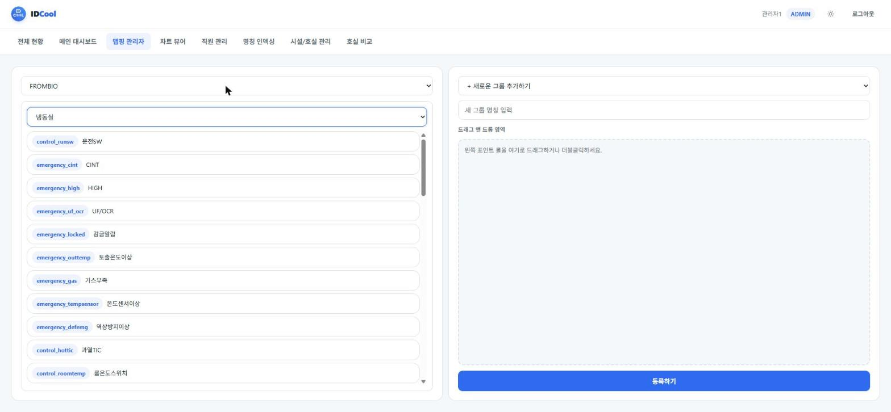 
<b>포인트 맵핑 관리자</b> 센서 포인트를 원하는 그룹으로 묶어서 보기 좋게 구성
</td>
</tr>
<tr>
<td colspan="2" width="100%" align="center">
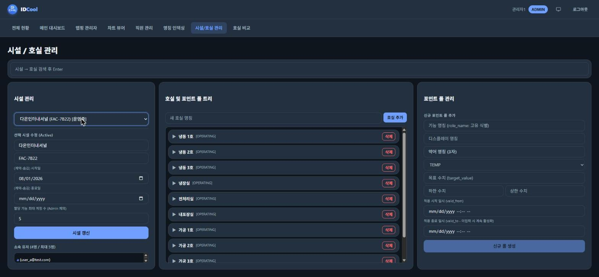 
<b>시설 / 호실 관리</b> 시설·호실·센서 포인트를 등록하고 계약 기간까지 관리
</td>
</tr>
</table>

### 🏗️ 어떻게 동작하나요?

창고 현장의 센서 값은 현장 수집기(`fac_server`/`DataIntercept`)가 읽어서 중앙 서버로 보내고,
중앙 서버(`idc_server_v2`)가 이를 저장했다가 모바일 앱과 웹 콘솔에 실시간으로 내려줍니다.
(위쪽 전체 구성도 참고)

| 구성 요소 | 역할 |
|---|---|
| 📱 모바일 앱 (Cool Eye) | 현장 직원용. 모니터링 · 차트 · 알람 · 게시판 · 채팅 |
| 💻 웹 관리자 콘솔 | 관리자용. 시설/센서 설정, 명칭 관리, 직원 권한 관리 |
| 🗄️ 중앙 서버 | 두 클라이언트가 함께 쓰는 데이터 저장소이자 API |
| 📡 현장 수집기 | 창고 현장에 설치되어 센서 데이터를 중앙 서버로 전송 |

### 🧰 기술 스택

| 영역 | 사용 기술 |
|---|---|
| 모바일 앱 | Flutter · Dart |
| 백엔드 | Python · FastAPI · SQLAlchemy(비동기) |
| 데이터베이스 | PostgreSQL · TimescaleDB (시계열 데이터) |
| 웹 관리자 콘솔 | React 19 · TypeScript · Vite · ECharts |
| 배포 | Docker (DB · Nginx · Redis · 서버 · 웹) |

### 🌿 브랜치 전략

`main`은 항상 운영 가능한 기준 브랜치로 유지합니다. 새 기능이나 디자인 작업은 별도
브랜치에서 진행한 뒤, 검토를 거쳐 `main`으로 병합합니다.

(<a href="#top">⬆ 맨 위로</a> · <a href="#-english">Go to English ver.</a>)

---

## 🇬🇧 English

### ❓ What is this?

A cold storage warehouse can ruin an entire inventory from a single temperature slip.
**IDCool** reads on-site sensors (temperature, gas pressure, compressor status, and more)
in real time, so anyone can check facility health and react to problems through a
**mobile app** or a **web admin console**.

- 🧑‍🔧 **On-site staff** check temperatures and alarms for their facilities right from their phone
- 🧑‍💻 **Admins** configure every facility/sensor and manage staff permissions from the web console
- 🚨 When something goes wrong, an **alarm fires immediately**, and the history stays on the chart for later review

### 👀 Mobile app (Cool Eye) tour

<table>
<tr>
<td width="33%" align="center">
 
<b>All facilities at a glance</b> Status colors tell you what needs attention, instantly
</td>
<td width="33%" align="center">
 
<b>Real-time data charts</b> Browse temperature trends over any time range
</td>
<td width="33%" align="center">
 
<b>Landscape quick-view</b> Oversized digits readable from across the room
</td>
</tr>
<tr>
<td width="33%" align="center">
 
<b>Alarms</b> Active and past alarms, all in one list
</td>
<td width="33%" align="center">
 
<b>Facility board</b> Share on-site issues and work notes as posts
</td>
<td width="33%" align="center">
 
<b>Messaging</b> 1:1 and group chat between staff and admins
</td>
</tr>
<tr>
<td width="33%" align="center">
 
<b>Settings — dark mode & language</b> Switch Korean ↔ English and light ↔ dark instantly
</td>
<td width="33%" align="center">
 
<b>Tablet auto-slide dashboard</b> Mount it on-site and let the screen rotate through rooms by itself
</td>
<td width="33%" align="center">
+ work logs, employee management, safe-range alerts, and more 🙂
</td>
</tr>
</table>

### 🖥️ Web admin console tour

<table>
<tr>
<td width="50%" align="center">
 
<b>Login</b> Sign in with email or a Google account
</td>
<td width="50%" align="center">
 
<b>M2M node management</b> Issue API keys for edge nodes and watch their connection status
</td>
</tr>
<tr>
<td width="50%" align="center">
 
<b>Live chart viewer</b> Overlay multiple sensor readings together with alarms and board posts
</td>
<td width="50%" align="center">
 
<b>Point mapping admin</b> Group sensor points however makes sense for each room
</td>
</tr>
<tr>
<td colspan="2" width="100%" align="center">
 
<b>Facility & room manager</b> Register facilities, rooms and sensor points, and track contract periods
</td>
</tr>
</table>

### 🏗️ How does it work?

On-site collectors (`fac_server` / `DataIntercept`) read sensor values and forward them to
the central server, which stores the data and streams it to both the mobile app and the
web console in real time (see the diagram above).

| Component | Role |
|---|---|
| 📱 Mobile app (Cool Eye) | For on-site staff — monitoring, charts, alarms, board, chat |
| 💻 Web admin console | For admins — facility/sensor setup, naming, staff permissions |
| 🗄️ Central server | Shared data store and API for both clients |
| 📡 Field collector | Installed on-site, forwards sensor data to the central server |

### 🧰 Tech stack

| Layer | Technology |
|---|---|
| Mobile app | Flutter · Dart |
| Backend | Python · FastAPI · SQLAlchemy (async) |
| Database | PostgreSQL · TimescaleDB (time-series data) |
| Web admin console | React 19 · TypeScript · Vite · ECharts |
| Deployment | Docker (DB · Nginx · Redis · server · web) |

### 🌿 Branch strategy

`main` is always kept in a deployable state. New features and design work happen on
separate branches and are merged back into `main` after review.

(<a href="#top">⬆ Back to top</a> · <a href="#-한국어">한국어로 보기</a>)

---

❄️ IDCool — Capstone Project 2026

